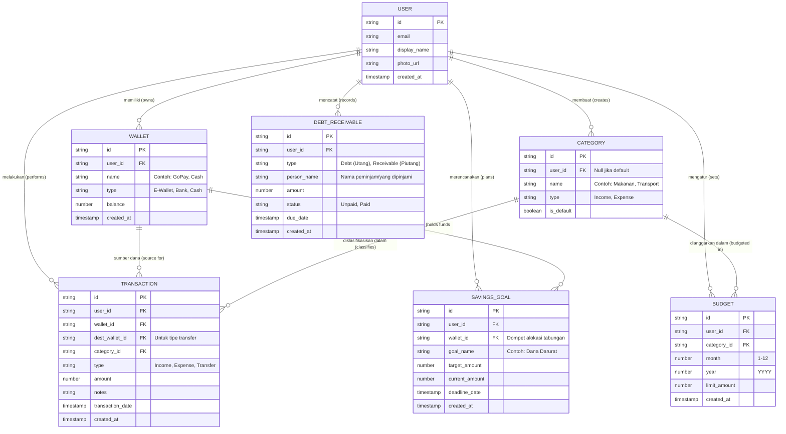

# Entity-Relationship Diagram (ERD)
**Proyek:** SmartFinance Web App

Dokumen ini mendefinisikan struktur database untuk aplikasi pencatatan keuangan. Karena aplikasi ini menggunakan Firebase (NoSQL), ERD ini mewakili struktur **Koleksi (Collections)** dan **Dokumen (Documents)** beserta relasi logis antar data.

## 1. Visualisasi ERD (Mermaid)

## 2. Penjelasan Entitas (Koleksi / Tabel)

### 2.1. `users`
Menyimpan data profil pengguna yang didapatkan dari Google Sign-In.
*   **Relasi:** 1 User memiliki banyak (One-to-Many) Dompet, Kategori, Transaksi, Anggaran, Tabungan, dan Utang-Piutang.

### 2.2. `wallets` (Sumber Dana)
Menyimpan berbagai sumber dana pengguna (Cash, E-Wallet, Rekening).
*   Field `balance` akan otomatis ter-update setiap kali ada transaksi baru.

### 2.3. `categories` (Kategori)
Daftar kategori transaksi.
*   Jika `is_default` bernilai `true`, kategori ini tersedia untuk semua orang (tidak terikat `user_id`).
*   Jika `is_default` bernilai `false`, ini adalah kategori kustom (custom) yang dibuat oleh user tertentu (`user_id` terisi).

### 2.4. `transactions` (Transaksi)
Tabel inti untuk mencatat arus kas.
*   Terdapat `dest_wallet_id` (opsional) yang hanya diisi jika `type` transaksi adalah *Transfer* (pemindahan saldo dari `wallet_id` ke `dest_wallet_id`).

### 2.5. `budgets` (Anggaran)
Mencatat batasan pengeluaran bulanan per kategori.
*   Terhubung ke `category_id` untuk memonitor total transaksi (Expense) pada bulan dan tahun tertentu, digunakan untuk memicu peringatan (warning) jika mendekati `limit_amount`.

### 2.6. `savings_goals` (Target Tabungan)
Mencatat rencana tabungan.
*   `wallet_id` mengindikasikan di mana uang tabungan ini secara fisik/digital disimpan.
*   `current_amount` dapat diperbarui melalui fitur "alokasi dana" di aplikasi.

### 2.7. `debts_receivables` (Utang & Piutang)
Modul terpisah untuk melacak utang dan piutang agar tidak bercampur dengan pengeluaran murni, sampai utang tersebut dibayarkan. Terdiri dari status `Unpaid` dan `Paid`.