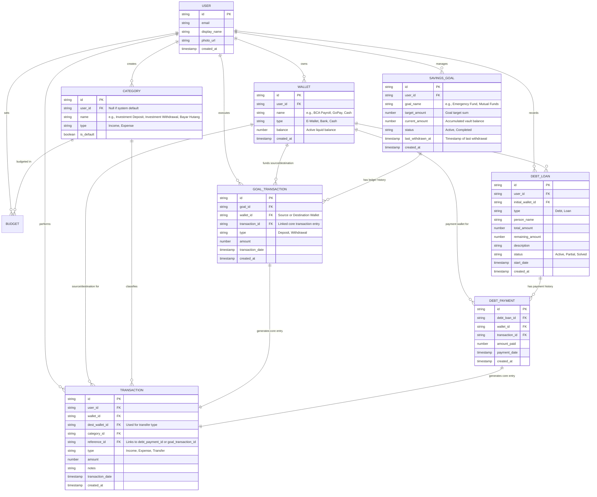

# Entity-Relationship Diagram (ERD)

**Project:** SmartFinance Web Application  
**Document:** Database Schema & Relationship Specifications (Savings & Investments Updated)

Dokumen ini mendefinisikan struktur NoSQL (Koleksi & Dokumen Firestore) beserta relasi logis antar entitas pada aplikasi SmartFinance.

---

## 1. Mermaid Visual Diagram

---

## 2. Entity Specification & Collection Details

### 2.1. `savings_goals` (Virtual Vault Goals)
Menyimpan data kartu target finansial/investasi pengguna.
* `current_amount`: Menggambarkan total dana yang saat ini tersimpan di dalam *vault*. Nilai ini mempengaruhi total kekayaan (*Total Net Worth*) tanpa perlu disimpan di wallet fisik mana pun.
* `last_withdrawn_at`: Dicatat saat terjadi aktivitas penarikan (*withdrawal*) untuk keperluan display footer pada UI.

### 2.2. `goal_transactions` (Investment Ledger)
Menyimpan riwayat spesifik setiap aktivitas **Deposit** maupun **Withdrawal** dari suatu target investasi.
* Setiap dokumen `goal_transactions` secara otomatis membuat entri pasangan di `transactions` utama dengan kategori terkunci **`Investment Deposit`** atau **`Investment Withdrawal`**.

### 2.3. Data Consistency & Atomic Updates (Firestore Batch Transactions)
Saat user melakukan *Deposit* atau *Withdrawal*:
1. **Deposit:** `wallet.balance` berkurang (-N) $\rightarrow$ `savings_goal.current_amount` bertambah (+N) $\rightarrow$ dokumen `goal_transactions` dicatat $\rightarrow$ entri `transactions` (Type: Expense/Transfer, Category: `Investment Deposit`) dicatat.
2. **Withdrawal:** `savings_goal.current_amount` berkurang (-N) $\rightarrow$ `wallet.balance` bertambah (+N) $\rightarrow$ `savings_goal.last_withdrawn_at` diperbarui $\rightarrow$ entri `transactions` (Type: Income/Transfer, Category: `Investment Withdrawal`) dicatat.