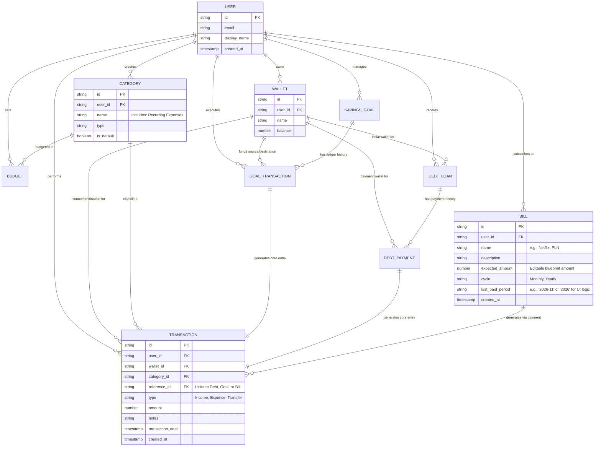

# Entity-Relationship Diagram (ERD)

**Project:** SmartFinance Web Application

**Document:** Database Schema & Relationship Specifications (Including Bills & Recurring Expenses)

Dokumen ini mendefinisikan struktur NoSQL (Koleksi & Dokumen Firestore) beserta relasi logis antar entitas pada aplikasi SmartFinance.

## 1. Mermaid Visual Diagram

## 2. Entity Specification & Collection Details

### 2.1. `bills` (Recurring Expenses Blueprint)

Koleksi ini menyimpan "cetak biru" dari tagihan-tagihan rutin milik pengguna.

* `expected_amount`: Menjadi patokan default saat menu pembayaran dibuka, namun tidak mengikat secara kaku (user bisa input nominal berbeda pada saat bayar).
* `last_paid_period`: Ini adalah kunci (*key mechanism*) untuk alur **Auto-Reset**. Alih-alih menjalankan proses *background/cron job* untuk mengubah status, UI akan melakukan pengecekan ini:
  * Jika `cycle == 'Monthly'`, dan `last_paid_period == '2026-11'` (Bulan Ini), maka tampilkan sebagai **"Paid"** dan geser ke bawah.
  * Ketika berganti bulan (menjadi `2026-12`), nilai `last_paid_period` otomatis kadaluarsa di mata UI, sehingga UI menampilkannya sebagai **"Unpaid"** dan menggesernya ke atas kembali.

### 2.2. Pembayaran Tagihan (Bill Payment Execution)

Saat pengguna melakukan "Pay Bill":
1. User input `Actual Amount`, `Wallet`, dan `Date`.
2. `wallet.balance` berkurang (-N).
3. Entri `transactions` baru dicatat: (Type: `Expense`, Category: `Recurring Expenses`, Amount: `Actual Amount`).
4. `bill.last_paid_period` diperbarui nilainya ke periode saat tanggal bayar (contoh: "2026-11"). Seluruh operasi pembaruan ini menggunakan *Atomic Batch* di Firestore.

### 2.3. Koleksi Sebelumnya (Reference)
Struktur untuk entitas *Transactions, Wallets, Categories, Savings Goals, Debts*, dan *Goal Transactions* tidak diubah dari skema sebelumnya, memastikan kompatibilitas penuh.