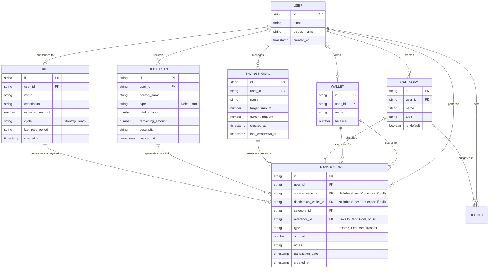

# Entity-Relationship Diagram (ERD)

**Project:** SmartFinance Web Application  
**Document:** Database Schema & Relationship Specifications

This document defines the NoSQL structure (Firestore Collections & Documents) and logical relationships, heavily updated to support the Reporting & Export module (specifically distinguishing Source and Destination wallets).

## 1. Mermaid Visual Diagram

## 2. Export Feature Implementation Notes

### 2.1. Transaction Schema Update (`source_wallet_id` & `destination_wallet_id`)
To accommodate the new Export requirement, the `TRANSACTION` entity replaces a single `wallet_id` with two distinct fields:
* **Expense:** `source_wallet_id` is populated. `destination_wallet_id` is `null`.
* **Income:** `source_wallet_id` is `null`. `destination_wallet_id` is populated.
* **Transfer (or Loan/Debt resolutions involving movement):** Both `source_wallet_id` and `destination_wallet_id` are populated.
* **Export Logic:** If a query returns `null` for either field, the export script will automatically replace the frontend output with a dash (`-`).

### 2.2. Querying for Exports
When a user requests an export, the application will perform a Firestore query against the `TRANSACTION` collection:
1.  **Filter:** `where("transaction_date", ">=", startDate)` and `where("transaction_date", "<=", endDate)`
2.  **Order:** `orderBy("transaction_date", "asc")` (To ensure chronological ascending order).
3.  **Aggregation:** The application will calculate the sum of Income and Expenses strictly from the queried document payload to generate the Dynamic Summary Cards in the PDF header.